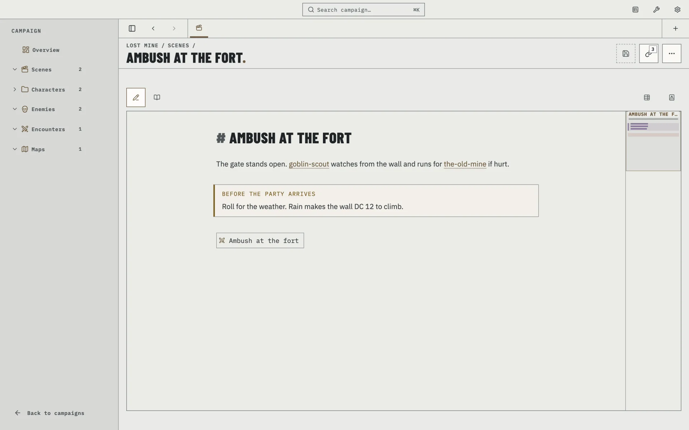
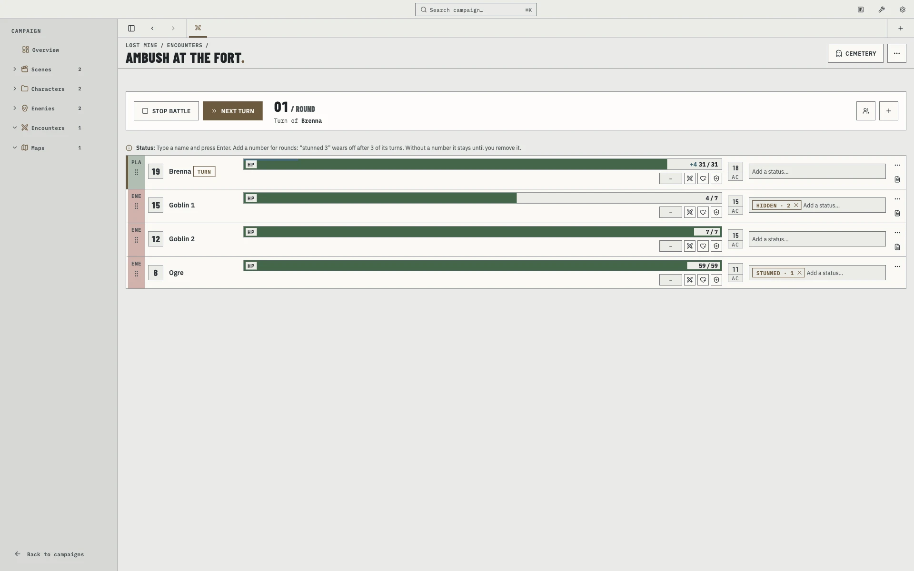
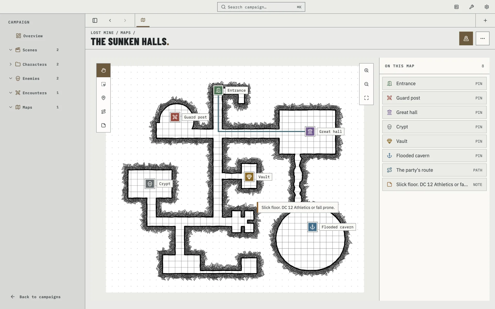
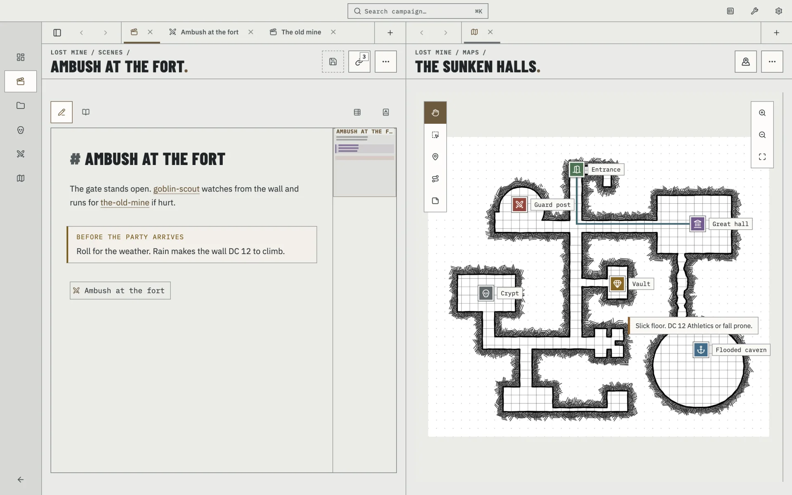

<div align="center">

# LazyDM.

**Prep at your desk. Run at the table.**

A desktop app for Dungeon Masters. Prepare your campaign and run it at the table from the same app, with notes that
stay plain Markdown in a folder you own.

[Website](https://lazydm.com) · [Issues](https://github.com/Tratt0re/lazydm/issues) · macOS · Windows · Linux

</div>

> **Status:** LazyDM is heading toward 1.0 and is not available to download yet. You can follow the project here, or
> build it yourself (see [Build from source](#build-from-source)).

<picture>
  <source media="(prefers-color-scheme: dark)" srcset="docs/images/social-card-dark.png" />
  
</picture>

<sub>All screenshots use made-up campaign data.</sub>

## The campaign stays yours

LazyDM calls your campaign folder the **Codex**. Its notes are ordinary `.md` files that LazyDM reads and edits
without locking them into a database. Every file stays yours, and your Markdown notes remain compatible with other
tools, including Obsidian.

- **Take it anywhere.** Move the folder, back it up or open its notes in any Markdown editor.
- **Lazy by design.** Sensible defaults and short paths keep preparation moving and table tools close.
- **Built from your files.** Search and links use a local index (SQLite) that LazyDM can rebuild from the Codex.
- **Make it comfortable.** Light and dark themes, in English, Italian, German, Spanish, French, Ukrainian and Chinese.

## Prepare at your desk

Write scenes, characters and enemies as notes, then connect them with `[[links]]`. Rename a note and LazyDM updates the
links to it. Before the session, **Review** shows you any broken links that need attention.

<picture>
  <source media="(prefers-color-scheme: dark)" srcset="docs/images/note-dark.webp" />
  
</picture>

- **Campaigns** with an overview and per-campaign sections (Enemies, Encounters, Assets…): hide, reorder, rename, add
  your own, and use sub-folders as sub-types.
- **Editor** with Live preview, Source and Reading views, clickable `[[wikilinks]]`, tables edited in place, Info boxes,
  a Properties box and a right-click insert menu.
- **Templates** give each kind of note a useful starting point, per note type and per campaign, and follow the campaign's
  game system (D&D 5e and Pathfinder 2e come with the keys a table needs: AC, HP, saves, spell details).
- **Links** shows what points to the open note and where that note leads next.
- **Compendium** keeps shared systems and content ready to copy into any campaign.
- **Assets**: paste or drop images, audio and PDFs into your notes. Audio plays inline and PDFs open in the system
  viewer.
- **Search** from the header, and file actions everywhere: rename, copy, move and delete (to the system Trash).

## Run at the table

When play begins, the campaign you prepared is already in front of you. Add Combatants, roll initiative and advance
through the turns while hit points, temporary hit points and timed statuses stay visible.

<picture>
  <source media="(prefers-color-scheme: dark)" srcset="docs/images/tracker-dark.webp" />
  
</picture>

- **Encounters** are `.json` files you link like any note (`![[ambush.json]]`).
- **Tracker layouts** decide the details each Combatant row shows. Pick the game system when you create a campaign
  (Generic, D&D 5e or Pathfinder 2e) and its layout and templates follow; change the layout or the row size later, and
  see it on mock Combatants before the session.
- **Battle bar** with Start battle, Stop battle and next turn, and the round and whose turn it is always visible.
- **Cemetery** keeps defeated enemies in case they return, and a **party roster** can be added to any encounter.

## Open the right place

Add a map image and place pins for the locations that matter. Link a pin to a note, and the guard post on the map opens
the guard post you prepared earlier.

<picture>
  <source media="(prefers-color-scheme: dark)" srcset="docs/images/map-dark.webp" />
  
</picture>

## Keep the scene together

Open any note, map or encounter beside another, each side with its own tabs. Drag tabs between the two panes. The same
note in both panes is one live document, and maps and encounters share one live state.

<picture>
  <source media="(prefers-color-scheme: dark)" srcset="docs/images/split-dark.webp" />
  
</picture>

## Bring the Codex with you

Keep the Codex on your computer, or put it in an iCloud, Dropbox, OneDrive, Box or Google Drive folder. Your cloud app
handles the sync; LazyDM waits for files still downloading and warns you about conflicting copies.

## AI-friendly, on your terms

When you choose to enable it, LazyDM can make the Codex available to an AI assistant running on the same computer
through a local MCP server. It stays off until you switch it on. It listens only on your own computer and asks for a
token. Writing is a separate switch, and so is deleting; both start off. Claude Code, OpenAI Codex and OpenCode can
connect to it. The design is in [`docs/design-principles.md`](docs/design-principles.md) §6f.

## Build from source

You need Node.js 18+ and npm 11+.

```bash
npm install
npm run build:preload
npm run dev            # Angular dev server + preload watch + Electron
```

| Command | What it does |
| --- | --- |
| `npm start` | Angular only, at `http://localhost:4200` (no Electron APIs) |
| `npm test` | Angular unit tests (Vitest) |
| `npm run test:electron` | Electron-side tests |
| `npx ng build --configuration development` | Fast type and template check |
| `npm run build:prod` | Production web build and preload bundle |
| `npm run build:desktop` | Unpackaged desktop app |
| `npm run dist` | Distributable for the current platform (`dist:mac`, `dist:win`, `dist:linux`) |

`electron/preload.bundle.cjs` is generated from `electron/preload.js` by `npm run build:preload` and is not in git. Every
dev and build script makes it first; run it yourself before starting Electron any other way.

## How it is built

| Area | Choice |
| --- | --- |
| UI | Angular 21 (standalone components, signals), Tailwind CSS 4 |
| Desktop | Electron 44 |
| Index | Better-SQLite3 (local and rebuildable) |
| Editor | CodeMirror 6 |
| i18n | ngx-translate |
| Components | ArcTechUI, the in-house component library |
| Tests | Vitest |

The renderer (Angular) is sandboxed and handles the UI. The Electron main process owns all file-system, index and sync
logic, and the two talk over typed IPC channels. A tour of the code is in [`docs/architecture.md`](docs/architecture.md).

## Contributing

The code is public, so you are welcome to read it, build it and open an issue. Before changing anything, read
[`docs/design-principles.md`](docs/design-principles.md): it is the source of truth for architecture, data placement,
sync, security and visual style, and for the words the UI uses (§1b). In short:

- Standalone components, signals, `inject()` and the `@/` path alias.
- User-facing strings go through i18n keys, in all 7 languages.
- Semantic theme tokens only (`bg-card`, `text-primary`…), never raw colours. Both themes must work.
- Prettier: `printWidth: 100`, single quotes.

Work happens on the `develop` branch: open pull requests against it, not `main`. Because the licence below does not allow commercial use, please open an issue to discuss a larger change before sending
a pull request.

## Documentation

| File | What |
| --- | --- |
| [`docs/design-principles.md`](docs/design-principles.md) | Architecture, data, sync, security, UI and visual rules, roadmap |
| [`docs/architecture.md`](docs/architecture.md) | Stack, code layout, routes and how to add a feature |
| [`CLAUDE.md`](CLAUDE.md) | Working notes for Claude Code |

## License

LazyDM is **source-available**, not open source in the OSI sense. It is licensed under the
[PolyForm Noncommercial License 1.0.0](LICENSE): you can read, run and modify it for personal and other noncommercial
use. Commercial use needs the author's permission. Future paid features may exist.

## Author

Salvatore De Luca ([@Tratt0re](https://github.com/Tratt0re))
