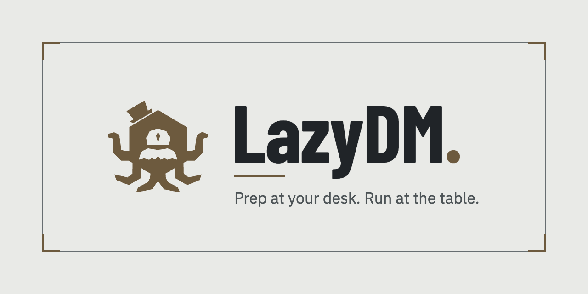

<div align="center">

# LazyDM website.

**The landing page for [LazyDM](https://github.com/Tratt0re/lazydm): prep at your desk, run at the table.**

Live at [lazydm.com](https://lazydm.com) · App repository: [Tratt0re/lazydm](https://github.com/Tratt0re/lazydm)

</div>

> This is the `website` branch. It is an orphan branch with no shared history with the app, which lives on `main` and
> `develop`. Every push here publishes the site; nothing on this branch is part of the app.



## What it is

One long page written as a LazyDM note: a Properties box, a title with Franco, an Info box, and sections for preparing,
running the table, maps, split screen, sync and the optional AI connection. It uses the app's own theme tokens and
fonts, with a System, Light and Dark theme menu, framed screenshots that tilt into place on scroll, and a code map
down the side that lists the section titles, as in the app.

Plain HTML, CSS and JS: no framework, no dependencies, no build step. English only for now.

## Run it

```bash
cd site
python3 -m http.server 8123   # then open http://127.0.0.1:8123/
```

## Layout

| Path | What |
| --- | --- |
| `site/index.html` | The page, and the icon sprite at its top |
| `site/assets/css/styles.css` | Tokens, fonts and ornaments copied from the app (`src/styles.css`) |
| `site/assets/js/theme-init.js` | Sets the theme before first paint (same `localStorage.theme` key as the app) |
| `site/assets/js/site.js` | The theme menu, the scroll-driven tilt of the screens and the code map (a port of the app's `code-map.ts`) |
| `site/assets/img/shots/` | Screenshots of the real app, one dark and one light each, in two sizes |
| `site/assets/img/og.png` | The share image used by Open Graph and Twitter cards |
| `site/assets/fonts/` | Barlow Condensed, IBM Plex Sans and Mono, from the app |
| `site/CNAME`, `robots.txt`, `sitemap.xml` | Domain and search files |
| `docs/social-card.png` | The 1280x640 social preview card, also shown at the top of this README |
| `PRODUCT.md` | Who the site is for and which claims are settled (read before editing copy) |
| `.github/workflows/deploy.yml` | Publishes `site/` to the `gh-pages` branch |

## Rules

- Keep the tokens in step with the app. Light is `:root`, dark is `:root.dark`; use the semantic variables, never raw colours.
- Words follow the app's glossary: Codex, Combatant, Tracker layout, Links, Review, Info box.
- Do not claim a price, a release date or "open source". The app is source-available under the PolyForm Noncommercial
  License, which is not an OSI open source licence. See `PRODUCT.md`.
- Every screenshot has a `-dark` and a `-light` file; the page shows the one that matches the theme. Retake both together.
- If the domain changes, change the canonical, Open Graph, JSON-LD, `robots.txt`, `sitemap.xml` and `CNAME` together.

## Deploy

The site is published the same way as the portfolio site:

1. A push to `website` runs `.github/workflows/deploy.yml`.
2. The workflow copies the contents of `site/` (and a `.nojekyll` file) into a fresh commit and force-pushes it to the
   `gh-pages` branch.
3. GitHub Pages serves `gh-pages` from its root, with the custom domain `lazydm.com`.

One-time setup in the repository: Settings, Pages, Source: **Deploy from a branch**, Branch: **`gh-pages`** / **root**,
Custom domain: `lazydm.com`, then **Enforce HTTPS**. The `CNAME` file in `site/` is carried into every deploy, so the
domain survives each one.

DNS at the registrar: four `A` records on `@` (`185.199.108.153`, `185.199.109.153`, `185.199.110.153`,
`185.199.111.153`), the four matching `AAAA` records (`2606:50c0:8000::153` to `2606:50c0:8003::153`), and a `CNAME` for
`www` pointing to `tratt0re.github.io`.

## Provenance of assets

- `site/assets/img/shots/*`: screenshots of the real LazyDM app (Angular build, 1440x900 at 2x, resized to 1920px wide
  and 960px wide), running in a browser with a faked `window.electronAPI` and made-up data (campaign "Lost Mine", the
  encounter and scene "Ambush at the fort"). The map is the sample dungeon supplied by the project owner.
- Franco and every icon are drawn from the app's own data (`franco.icon.ts` and the Lucide set it uses), written into
  the icon sprite at the top of `site/index.html`.

## Retaking the screenshots

Start the app's dev server (`npx ng serve` in the app repo), load `/campaigns/lost-mine` with a fake
`window.electronAPI`, and capture the encounter, the map, a note and the split screen (open `/campaigns/lost-mine` with
`window.__workspace` set to a left tab and a right tab) in both themes at 1440x900. Convert to WebP at 1920px and 960px
wide.

## License

The website follows the app's licence: [PolyForm Noncommercial License 1.0.0](https://github.com/Tratt0re/lazydm/blob/main/LICENSE).

## Author

Salvatore De Luca ([@Tratt0re](https://github.com/Tratt0re))
